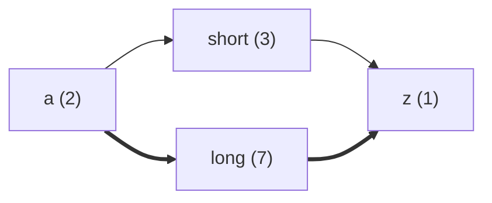

# loadpath

[](https://github.com/edxeme/loadpath/actions/workflows/ci.yml)

Small polyglot exercise: critical-path analysis over a weighted task DAG,
implemented independently in **Java**, **Rust** and **C++**, validated against
the same hand-checked test vectors.

Twenty years of schedules taught me one thing: the longest path is the only
one that matters. This repo is the same algorithm written three times — the
interesting part is not the graph theory, it is what each language makes
easy, hard, and loud.

## Algorithm

1. Topological walk over the dependency DAG.
2. `earliest_finish(task) = max(finish of predecessors) + duration`.
3. The critical path is reconstructed backwards through the dominating
   predecessor of the last task to finish.
4. A reverse-Kahn backward pass yields `late_start`/`late_finish` and the
   total float per task; `schedule()` reports all of it, `critical_tasks()`
   collects the zero-float set.
5. Tied branches mean more than one critical path: `critical_paths()` walks
   the zero-float subgraph through *binding* edges — edges whose predecessor
   finish equals the successor start, so no float can ever open between them.

Cycles are rejected. Results are stable: task and edge insertion order breaks
ties identically in every port.

## Layout

```
java/    Maven project, JUnit 5
rust/    Cargo crate, std-only
cpp/     CMake project, zero-dependency test harness
fixtures/cases/*.tsv   shared test vectors, consumed by all three suites
```

| Module | Build | Test |
| --- | --- | --- |
| `java/` | `mvn -f java/pom.xml package` | `mvn -f java/pom.xml test` |
| `rust/` | `cargo build --manifest-path rust/Cargo.toml` | `cargo test --manifest-path rust/Cargo.toml` |
| `cpp/`  | `cmake -S cpp -B cpp/build && cmake --build cpp/build` | `ctest --test-dir cpp/build --output-on-failure` |

## Fixtures

Vectors are plain TSV so each port parses them natively:

```tsv
task	start	0
task	excavate	4
edge	start	excavate
expect_path	start,excavate
expect_makespan	4
```

Adding a case means adding one file; all three suites pick it up on the next
run. This caught real drift twice during development — a mutation bug in the
Java topological walk and a working-directory assumption in the C++ runner.

## Diagram export

Every port renders the same Mermaid flowchart: heavy arrows on binding
critical edges, labels carrying the duration. Feed `toMermaid()` /
`to_mermaid()` output straight into any Mermaid renderer:



Golden tests pin the exact rendering in all three ports, indentation included.

## Implementation notes

- **Java** leans on records and a fluent builder; the shortest of the three in
  ceremony, the longest in runtime warm-up. JUnit does the heavy lifting.
- **Rust** is the only one that forced the error story into the type system
  (`Result<&mut Self, CpmError>`); `clippy` + `rustfmt` clean, no deps.
- **C++** throws for builder errors and carries a 60-line registry-based test
  harness instead of a framework — for this size, the harness is the honest
  choice.

~1930 lines across the three ports, no third-party dependencies beyond the
Java test scope.

## Roadmap

- [x] Late start/finish and total float per task
- [x] Multiple critical paths
- [x] Mermaid export of the schedule graph

## License

MIT
